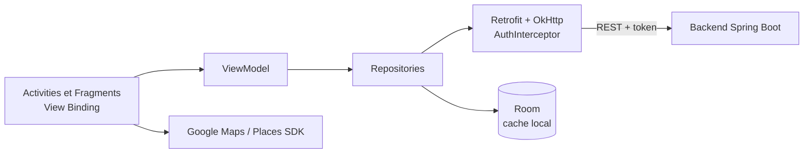

<p align="right"><a href="README.md">EN</a> | <b>FR</b></p>

# Yallah

Application Android pour découvrir et réserver des activités de plein air et de loisirs (randonnée, surf, yoga, visites culturelles, etc.). Les utilisateurs réservent des activités autour d'eux ; les organisateurs vérifiés publient leurs propres activités et suivent leurs réservations depuis un tableau de bord.


## Fonctionnalités

| Pour les utilisateurs | Pour les organisateurs |
|---|---|
| Inscription et connexion | Passage au statut d'organisateur après vérification d'identité (passeport ou carte nationale) |
| Parcourir les activités par catégorie et les filtrer | Création d'une activité en trois étapes : détails, photos, localisation |
| Détail d'une activité avec galerie d'images et carte | Choix du point de rendez-vous sur Google Maps avec recherche de lieux |
| Réservation d'une activité et liste des réservations | Tableau de bord avec statistiques de réservation (graphiques en secteurs et en barres) |
| Gestion du profil | Suppression d'une activité |

Plus de 30 catégories d'activités sont proposées, de la randonnée au kayak en passant par la dégustation de vin ou la montgolfière.

## Architecture



- **MVVM :** interface dans les Activities et Fragments, état dans un `ViewModel`, accès aux données via des repositories.
- **Réseau :** Retrofit avec Gson ; un intercepteur OkHttp ajoute le token de l'utilisateur à chaque requête.
- **Persistance locale :** base Room pour l'utilisateur connecté, `SharedPreferences` pour la session.
- **Interface :** Material Components, navigation inférieure et menu latéral, carrousel d'images `ViewPager2`, Glide pour les images, MPAndroidChart pour le tableau de bord organisateur.

## Démarrage

Prérequis : Android Studio, JDK 17, un appareil ou émulateur Android (API 26+).

Ajouter les clés suivantes dans `local.properties` à la racine du projet. Ce fichier n'est pas versionné.

```properties
MAPS_API_KEY=votre_cle_google_maps
API_BASE_URL=http://10.0.2.2:8080
```

| Clé | Description |
|---|---|
| `MAPS_API_KEY` | Clé API Google Maps et Places (Maps SDK for Android et Places API activés) |
| `API_BASE_URL` | URL du backend. `10.0.2.2` correspond à la machine hôte depuis l'émulateur Android. |

Ouvrir ensuite le projet dans Android Studio et lancer la configuration `app`, ou :

```bash
./gradlew installDebug
```
