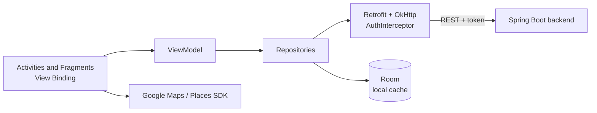

<p align="right"><b>EN</b> | <a href="README.fr.md">FR</a></p>

# Yallah

An Android app for discovering and booking outdoor and leisure activities (hiking, surfing, yoga, cultural tours and more). Users book activities near them; verified organizers publish their own activities and follow their bookings from a dashboard.


## Features

| For users | For organizers |
|---|---|
| Sign up and log in | Become an organizer after identity verification (passport or national ID card) |
| Browse activities by category and filter them | Create an activity in three steps: details, photos, location |
| Activity details with image gallery and map | Pick the meeting point on Google Maps with place search |
| Book an activity and see booked activities | Dashboard with booking statistics (pie and bar charts) |
| Profile management | Remove an activity |

More than 30 activity categories are supported, from hiking and kayaking to wine tasting and hot-air balloon rides.

## Architecture



- **MVVM:** UI in Activities and Fragments, state in a `ViewModel`, data access through repositories.
- **Networking:** Retrofit with Gson; an OkHttp interceptor adds the user's token to every request.
- **Local persistence:** Room database for the logged-in user, `SharedPreferences` for the session.
- **UI:** Material Components, bottom navigation and drawer, `ViewPager2` image slider, Glide for image loading, MPAndroidChart for the organizer dashboard.

## Getting started

Requirements: Android Studio, JDK 17, an Android device or emulator (API 26+).

Add the following keys to `local.properties` at the project root. This file is not committed.

```properties
MAPS_API_KEY=your_google_maps_api_key
API_BASE_URL=http://10.0.2.2:8080
```

| Key | Description |
|---|---|
| `MAPS_API_KEY` | Google Maps and Places API key (Maps SDK for Android and Places API enabled) |
| `API_BASE_URL` | Backend URL. `10.0.2.2` points to the host machine from the Android emulator. |

Then open the project in Android Studio and run the `app` configuration, or:

```bash
./gradlew installDebug
```
